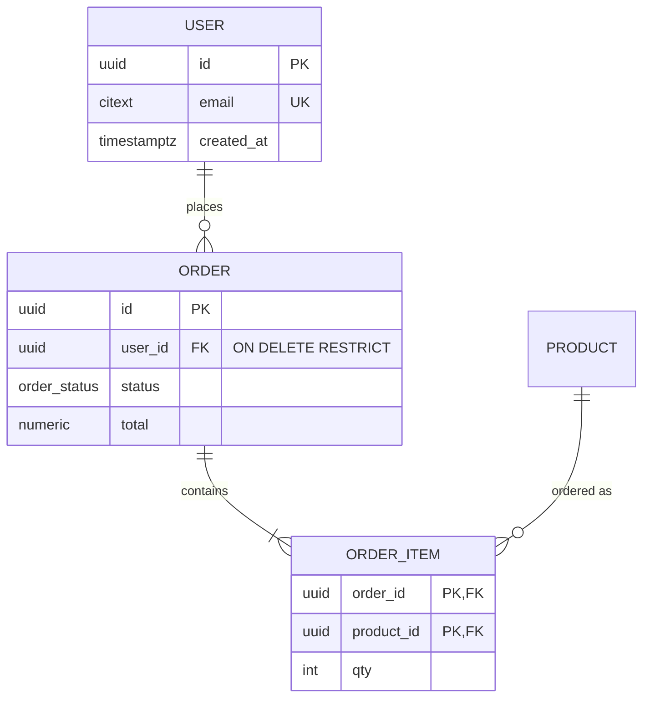

# ER diagram

## 1. Find the source of truth

Prefer, in order: the live schema (`pg_dump --schema-only`, `prisma db pull`, `sqlite3 .schema`) → migrations folder → ORM models → docs. Say which you used. Where migrations and models disagree, the database wins; flag the drift.

Typical locations:

| Stack | Look at |
|---|---|
| Prisma | `prisma/schema.prisma` |
| Drizzle | `src/db/schema*.ts` |
| TypeORM / MikroORM | `*.entity.ts`, decorators `@ManyToOne` etc. |
| SQLAlchemy / Alembic | `models/*.py`, `alembic/versions` |
| Django | `*/models.py`, `*/migrations` |
| Rails | `db/schema.rb`, `db/structure.sql` |
| GORM | structs with `gorm:` tags |
| Mongoose | `*.schema.ts/js` (document refs, not FKs) |
| Raw SQL | `migrations/*.sql`, `schema.sql` |

## 2. Extract

For each table/collection: name, primary key, columns with type, unique keys, foreign keys with on-delete behavior, indexes that matter for the question, soft-delete and tenant columns. For each relation: cardinality on both sides and whether it is optional. Derive cardinality from constraints, not names: `NOT NULL` FK → mandatory; unique FK → one-to-one; join table with composite PK → many-to-many.

## 3. Output

**Mermaid (default, for Markdown/GitHub):**

Cardinality: `||` exactly one, `|o` zero or one, `}|` one or more, `}o` zero or more. Left symbol belongs to the left entity. Use `..` instead of `--` for non-identifying relations if the team cares about the distinction.

**DBML (for dbdiagram.io / dbdocs):** see [reference/dbml.md](reference/dbml.md).

**draw.io (editable, for architecture docs):** write a graph for the `repo-to-drawio` skill or hand-place tables with the ER table pattern in its `reference/drawio-xml.md`.

## 4. Keep it readable

- One diagram per bounded context / module; over ~15 tables, split and add an overview diagram with only the core entities.
- Show every column only for the central tables; for peripheral tables, show PK/FK and 2–3 key columns, and say so in a note.
- Name the enum types and list their values below the diagram.
- Add a "Sources" line with the files or command the diagram was derived from and the date.

## Reviewing a proposed schema

Check: every table has a stable PK; FKs have indexes; `ON DELETE` is intentional; nullable FKs are meant to be optional; many-to-many has a join table with a composite unique; timestamps are `timestamptz`; money is `numeric`, not float; multi-tenant tables carry `tenant_id` in unique keys; naming is consistent (snake_case plural or singular, pick one). Report problems as a ranked list with a concrete fix each.
