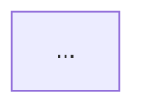

# Mermaid diagrams

Mermaid renders in GitHub, GitLab, VS Code, Notion, Obsidian and most doc sites, so it is the default for diagrams that live next to code. See [reference/syntax.md](reference/syntax.md) for per-type syntax and gotchas.

## Choose the type

| Question | Type |
|---|---|
| What are the steps / decisions? | `flowchart TD` (or `LR` for pipelines) |
| Who calls whom, in what order? | `sequenceDiagram` |
| What states can this thing be in? | `stateDiagram-v2` |
| How are the tables related? | `erDiagram` (see the `er-diagram` skill for deriving it from code) |
| What are the classes/types and their relations? | `classDiagram` |
| System context / containers for stakeholders | `C4Context`, `C4Container` |
| Schedule | `gantt` |
| Branching strategy | `gitGraph` |
| User experience over steps | `journey` |
| Brainstorm / hierarchy | `mindmap` |
| Events over time | `timeline` |

## Rules that keep diagrams readable

1. One diagram answers one question. Over ~25 nodes: split, or group with `subgraph`.
2. Node labels: 2–5 words. Put detail in a note or the surrounding prose, not in the box.
3. Edge labels: 1–3 words (`yes`, `no`, `async`, `reads`).
4. Flow direction: `TD` for decision flows, `LR` for pipelines and data flow.
5. Give nodes short ids (`auth`, `db`) and readable labels (`auth[Auth middleware]`); never rely on the id as the label.
6. Quote labels with special characters: `a["POST /orders (v2)"]`. Characters that break parsing unquoted: `( ) [ ] { } | " ; :` and `end` as a bare word.
7. Decisions are `{Valid?}`; start/end are `([Start])`; databases `[(orders)]`; external systems `[[Email API]]`; queues `>order.created]`.
8. Keep direction consistent; avoid edges that go back up unless they are real loops (label them `retry`, `loop`).
9. Add a `%% comment` at the top saying what the diagram shows and the source it was derived from.
10. Match the language of labels to the document's language.

## Drawing from code

Read the actual code paths first (routes → handlers → services → storage → external calls). Every node and edge should map to a file or function you can name; list those under the diagram in the doc as a "Sources" line, so a reviewer can check it.

## Embedding

In Markdown:

````markdown

````

GitHub renders this directly. For Confluence or slides, render to SVG with the Mermaid CLI: `npx -y @mermaid-js/mermaid-cli -i docs/flow.mmd -o docs/flow.svg` (ask before installing).

## Verify

Before handing over, check: every id used in an edge is defined; quotes are balanced; no bare `end` ids; `sequenceDiagram` participants are declared in the order you want them shown; `classDiagram` relation arrows point the right way (`A --|> B` means A inherits B). If a Mermaid preview is available (VS Code "Markdown Preview Mermaid Support", or the draw.io MCP `create_diagram` with `mermaid`), render once and fix what does not parse.
