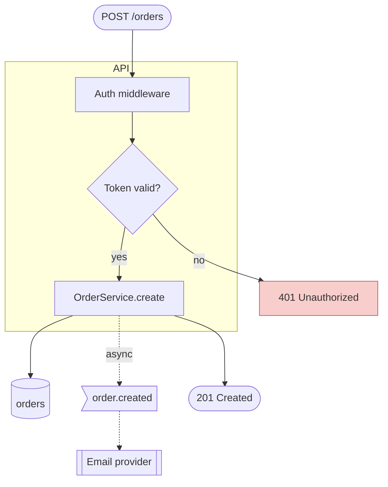
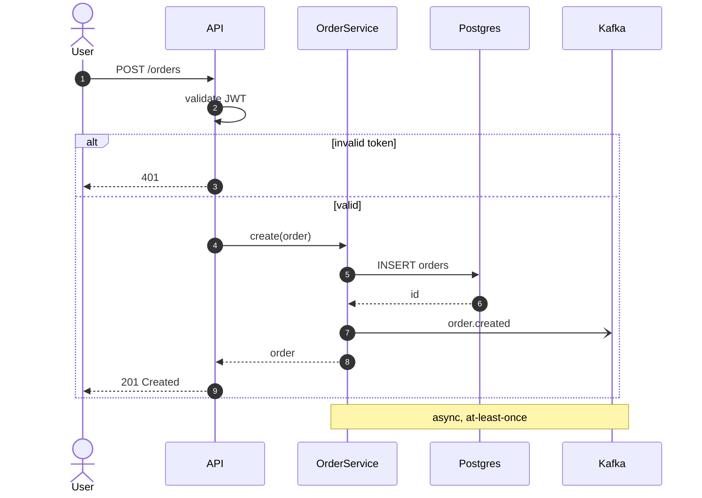
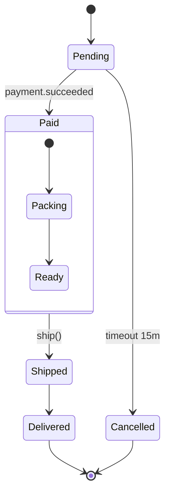
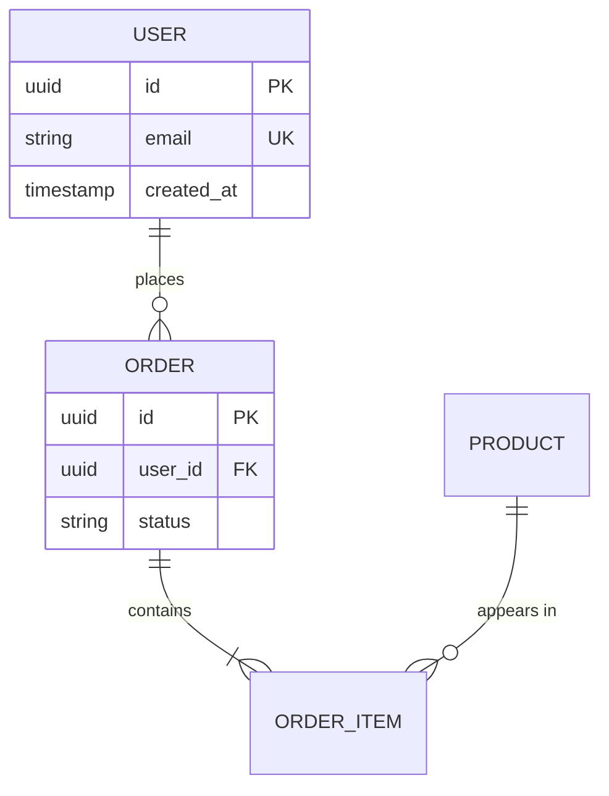
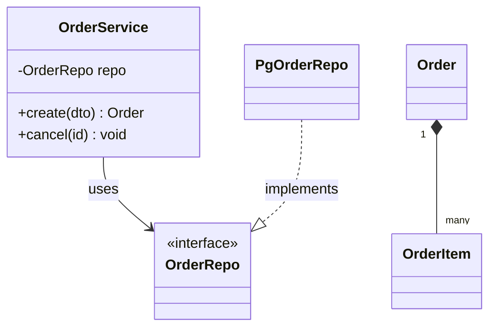
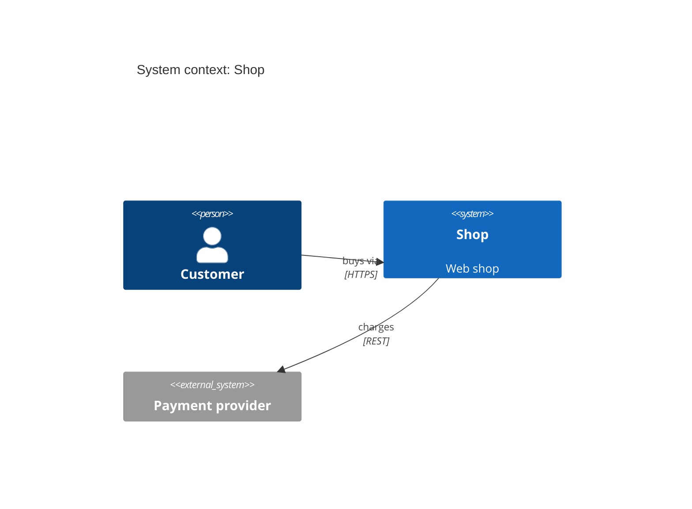
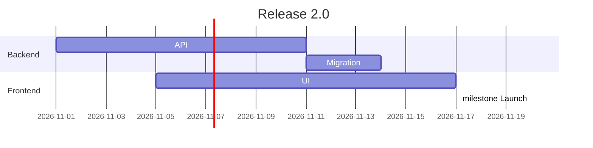
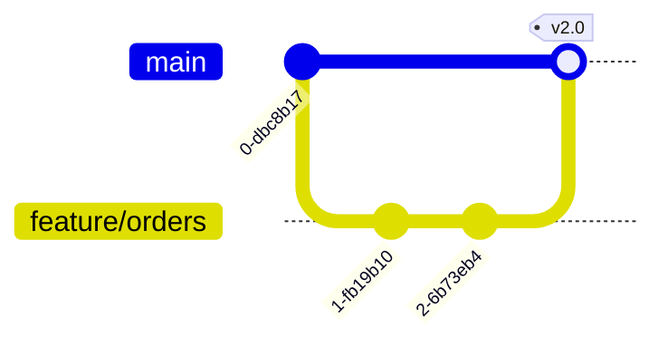
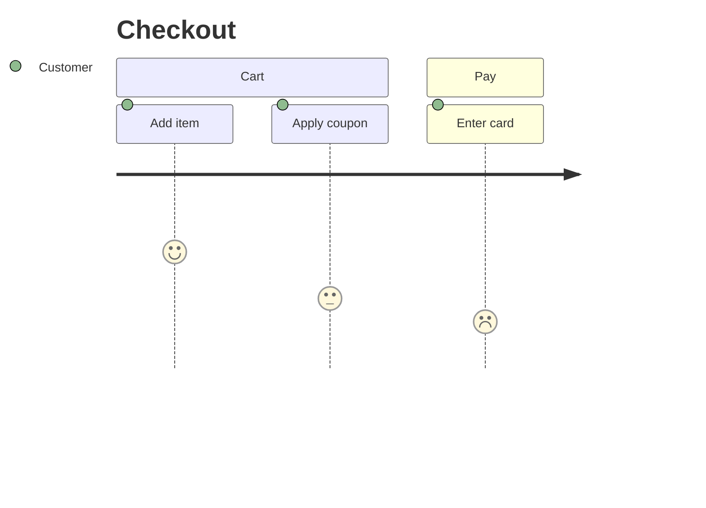
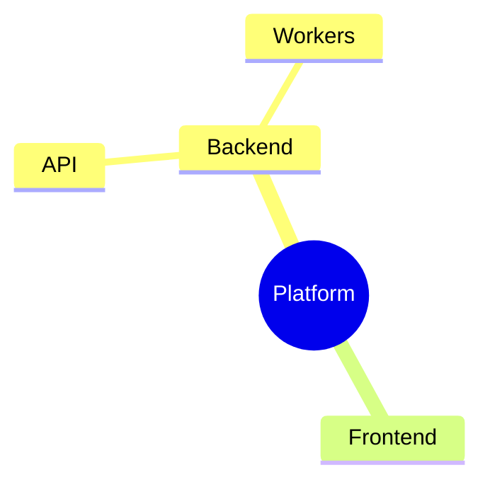

# Mermaid syntax cheat sheet

## flowchart



Shapes: `[rect]` `(rounded)` `([stadium])` `[[subroutine]]` `[(cylinder)]` `((circle))` `>flag]` `{diamond}` `{{hexagon}}` `[/parallelogram/]`.
Edges: `-->` solid arrow, `---` line, `-.->` dotted, `==>` thick, `--text-->` or `-- text -->` labeled, `-->|text|` labeled.
Direction: `TD`/`TB`, `LR`, `RL`, `BT`. Subgraphs can have their own `direction LR`.
Click: `click svc "https://github.com/org/repo/blob/main/src/services/order.ts"`.

## sequenceDiagram



Arrows: `->>` sync call, `-->>` return, `-)` async (no wait), `-x` lost. Blocks: `alt/else/end`, `opt`, `loop`, `par/and`, `critical`, `break`, `rect rgb(240,240,240)`. `activate X` / `deactivate X` or `+`/`-` suffix on arrows.

## stateDiagram-v2



## erDiagram



Cardinality: `|o` zero or one, `||` exactly one, `}o` zero or more, `}|` one or more. Left symbol = left entity's side. `--` identifying, `..` non-identifying.

## classDiagram



Relations: `<|--` inheritance, `*--` composition, `o--` aggregation, `-->` association, `..>` dependency, `..|>` realization.

## C4



Also `C4Container`, `C4Component`, `C4Deployment`; `Container(id, name, tech, desc)`, `ContainerDb`, `Container_Boundary(id, name) { ... }`.

## gantt



## gitGraph



## journey, mindmap, timeline





```mermaid
timeline
  title Incident 2026-10-18
  09:02 : Alert fired
  09:10 : Rollback started
  09:15 : Recovered
```

## Common parse errors

- Unquoted `(`, `)`, `|`, `:` in a label → wrap in `"..."`.
- A node named `end` → rename (`finish`).
- `sequenceDiagram` message text containing `;` → remove or quote.
- Missing `-v2` on `stateDiagram` when using composite states.
- `classDiagram` method with generics: write `List~Order~` for `List<Order>`.
- Blank line inside a `subgraph` block is fine; a blank line between the ```` ```mermaid ```` fence and the header is not.
- Theme/config: a front-matter block is allowed at the top:
  ```
  ---
  config:
    theme: neutral
    flowchart:
      curve: basis
  ---
  ```
